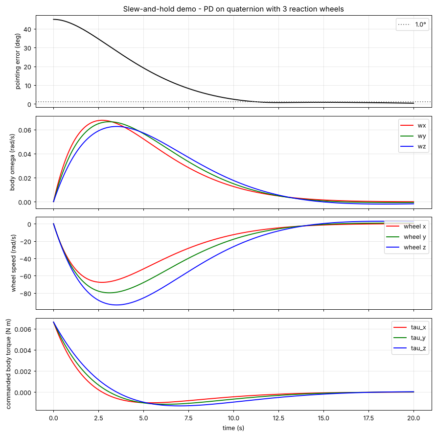

# OpenLodestar

Open-source **spacecraft Attitude Determination and Control (ADCS)** simulator, written in Python.

A *lodestar* is a navigation star. OpenLodestar simulates the closed loop a satellite needs to go from tumbling to precisely pointing at a target and holding that orientation.

> **Status:** v0.3.0. Rigid-body dynamics, reaction wheels and a quaternion PD controller are implemented and tested (49 tests). Sensors and attitude estimation are the next phase.



*45° slew around (1, 1, 1) and hold on a CubeSat-size body: pointing error under 1° after 11.4 s, 0.38° at 20 s, peak wheel speed 94 rad/s of the 800 rad/s limit (`examples/slew_and_hold.py`).*

## What works now

- **Quaternion kinematics** (Hamilton convention, scalar first): product, conjugate, vector rotation and q̇ = ½ q ⊗ (0, ω).
- **Rigid-body dynamics** with Euler's equation, I ω̇ = τ − ω × I ω, integrated with `scipy.integrate.solve_ivp`.
- **Reaction wheels** with saturation on motor torque and on wheel speed, the reaction torque on the body and the gyroscopic coupling ω × (I ω + h_wheels).
- **Quaternion PD controller**, τ = −Kp q_e,vec − Kd ω, on the shortest-rotation error quaternion, with allocation of the body torque to 3 orthogonal wheels.
- **Physical checks** in the test suite: zero kinetic-energy rate in torque-free motion, angular momentum changing exactly with the applied torque, and the wheel momentum bookkeeping.

## Examples

| Script | What it shows |
|---|---|
| `examples/cube_matrix.py` | A 3D cube rotated with a rotation matrix |
| `examples/cube_quaternion.py` | The same rotation with a quaternion |
| `examples/tumble_simulation.py` | Torque-free tumbling body: angular velocity and quaternion telemetry |
| `examples/tumble_animation.py` | 3D animation of the intermediate-axis instability (Dzhanibekov effect) |
| `examples/slew_and_hold.py` | Closed-loop slew and hold with 3 reaction wheels and the PD controller |

## Installation

```bash
git clone https://github.com/sebastianabelloc/openLodestar.git
cd openLodestar
pip install -r requirements.txt
python -m pytest -q
python examples/slew_and_hold.py
```

Requires Python 3.10+, NumPy, SciPy and Matplotlib.

## Repository layout

```
openlodestar/
├── dynamics.py           Euler's equations, coupled spacecraft + wheels dynamics, angular momentum
├── actuators.py          reaction wheel model with torque and speed saturation
├── control.py            error quaternion, PD-on-quaternion law, wheel allocation
└── utils/quaternions.py  quaternion operations
examples/                 runnable demos (see table above)
tests/                    pytest suite: quaternions, dynamics, wheels, control, simulation
```

## Technical conventions

- **Quaternions:** Hamilton, (w, x, y, z), mapping body vectors to inertial vectors. Documented in `utils/quaternions.py`.
- **Frames:** inertial and body. Angular velocity is expressed in the body frame.
- **Units:** SI (kg, m, s, rad).
- **Integration:** `scipy.integrate.solve_ivp` (RK45).

## Roadmap

- [x] **Phase 0 — Foundations.** Rotation matrices, quaternions, rotating a 3D cube. *(v0.1.0)*
- [x] **Phase 1 — Dynamics.** Free rigid body, Euler's equations, tumbling and the Dzhanibekov effect in 3D. *(v0.2.0)*
- [x] **Phase 2 — Actuators and control.** Reaction wheels with saturation, quaternion PD control, slew and hold. *(v0.3.0)*
- [ ] **Phase 3 — Sensors and estimation.** Noisy gyro and star tracker, TRIAD/QUEST and a multiplicative EKF, closing the loop on the estimated attitude.
- [ ] **Phase 4 — Mission and validation.** Detumble → point → hold with external disturbances, core port to C++ and cross-check against MATLAB/Simulink.

Beyond v1.0: YAML configuration, magnetorquers for wheel desaturation, CMGs, richer visualization.

## Theoretical references

- Wertz, J. R. — *Spacecraft Attitude Determination and Control*.
- Markley, F. L. & Crassidis, J. L. — *Fundamentals of Spacecraft Attitude Determination and Control*.
- Sidi, M. J. — *Spacecraft Dynamics and Control: A Practical Engineering Approach*.
- Schaub, H. — *Spacecraft Dynamics and Control* specialization, University of Colorado Boulder.
- 3Blue1Brown — *Essence of Linear Algebra* (linear-algebra background).

## License

MIT — see [`LICENSE`](LICENSE).

## Author

Sebastián Abello — aerospace engineer focused on GNC. OpenLodestar is both a publishable tool and the way I'm learning attitude dynamics and control by building it.
